# 🕋 Rafiq - Islamic Lifestyle App for Android & iOS (Kotlin Multiplatform)

<p align="center">
  <a href="https://github.com/suryamudti/rafiq-android/actions/workflows/pr-check.yml"></a>
  <a href="https://github.com/suryamudti/rafiq-android/actions/workflows/release.yml"></a>
  <a href="https://kotlinlang.org/docs/multiplatform.html"></a>
  <a href="https://kotlinlang.org"></a>
  <a href="https://developer.android.com/about/versions/marshmallow"></a>
  <a href="https://developer.android.com/jetpack/compose"></a>
  <a href="https://insert-koin.io/"></a>
  <a href="https://dagger.dev/hilt/"></a>
</p>

<p align="center">
<b>Rafiq</b> demonstrates modern cross-platform mobile development with <b>Kotlin Multiplatform (KMP)</b>, Compose Multiplatform, Jetpack Compose (Material3), Koin, Coroutines, Flow, Room KMP, and Ktor based on <b>Clean Architecture</b> and <b>MVVM</b> multi-module guidelines, elevated by <b>Emil Kowalski's Design Engineering philosophy</b> and responsive spring micro-interactions.
</p>

---

## 📥 Download

Go to the [Releases](https://github.com/suryamudti/rafiq-android/releases) section to download the latest APK.

---

## 📸 Screenshots

| Dashboard | Prayer Times | Quran Reader | Ayah Reader |
| :---: | :---: | :---: | :---: |
| 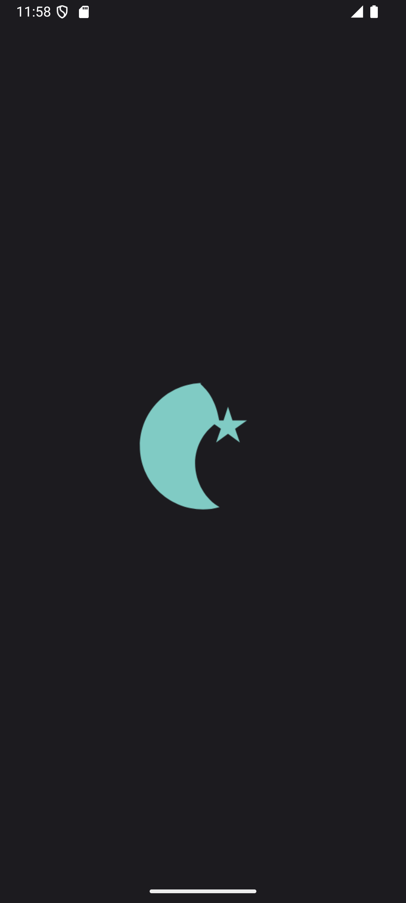 | 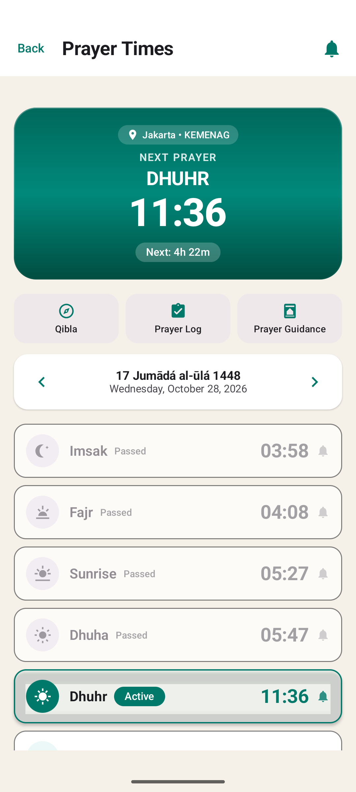 | 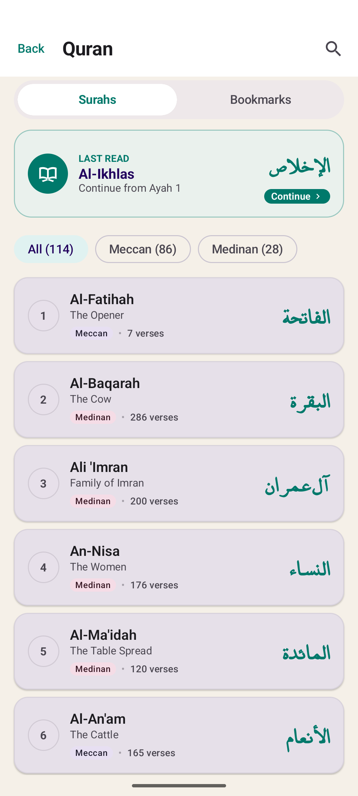 | 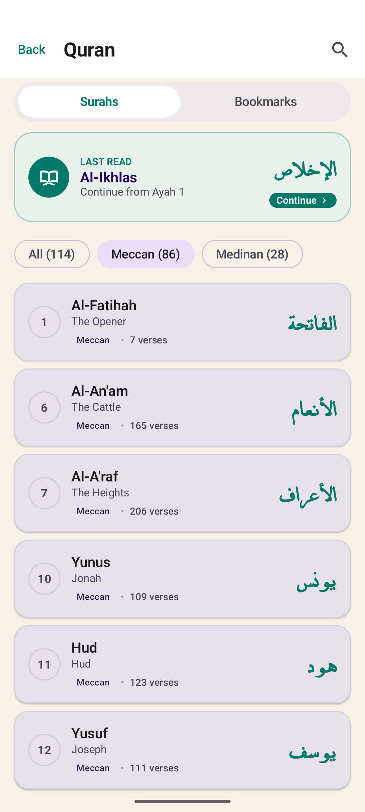 |

| Qibla Compass | Zakat Calculator | 99 Names of Allah | Tasbih Counter |
| :---: | :---: | :---: | :---: |
| 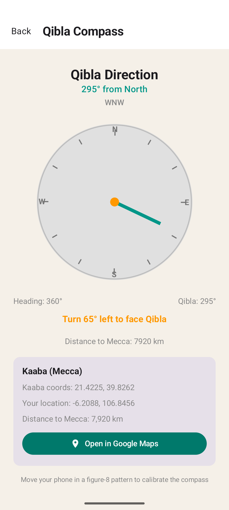 | 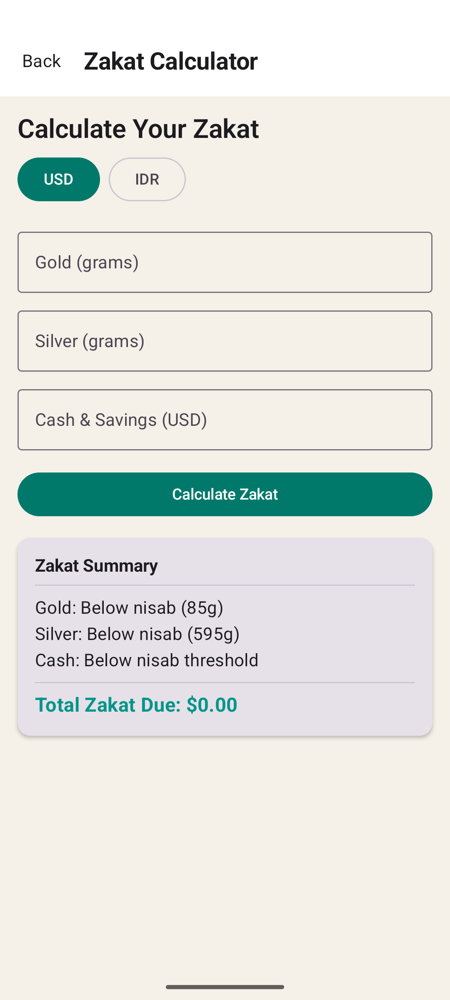 | 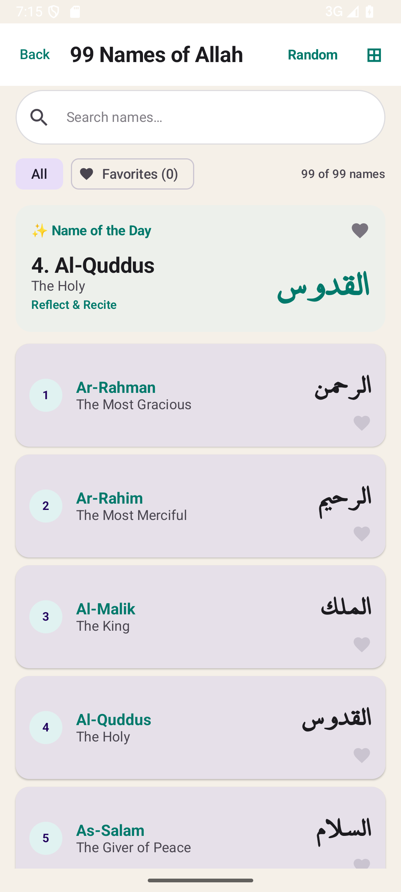 | 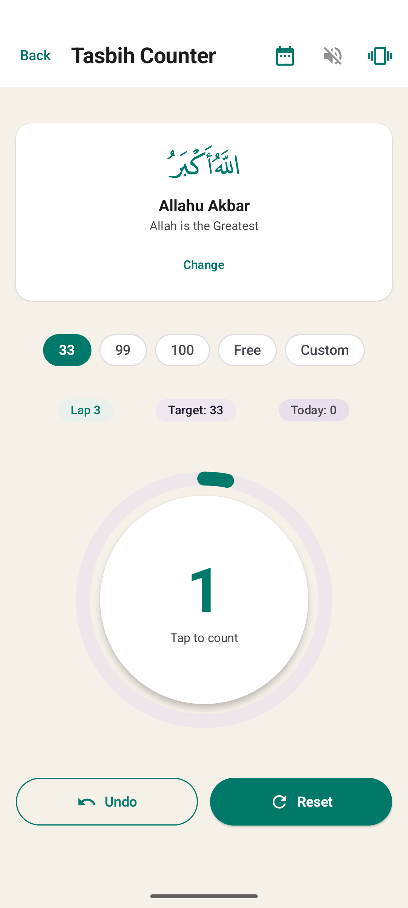 |

| Nearby Mosques | Hadith Library | Prophet Stories | Islamic Calendar |
| :---: | :---: | :---: | :---: |
| 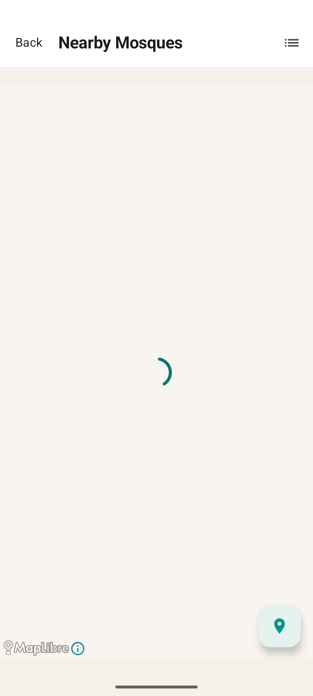 | 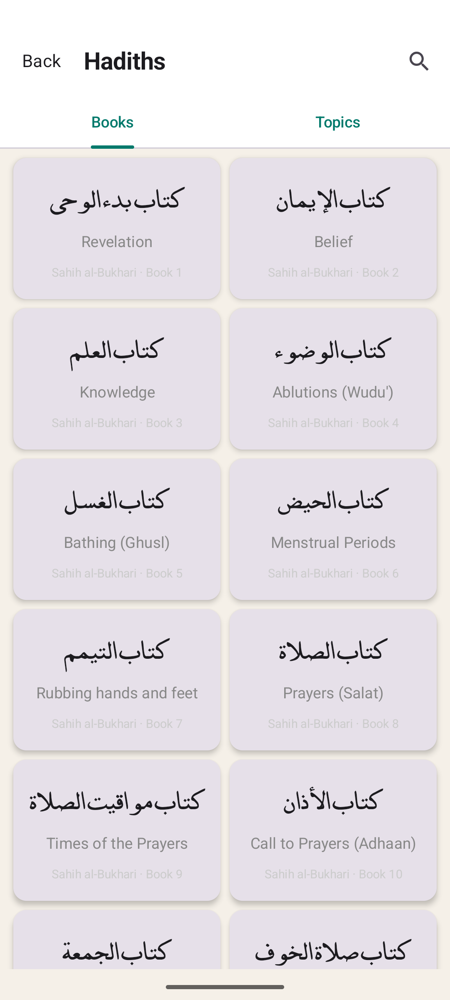 | 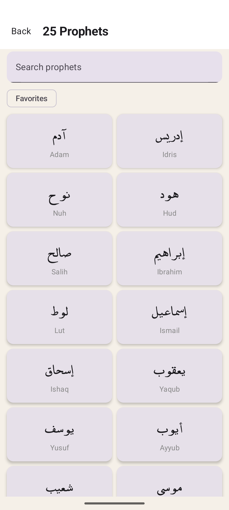 | 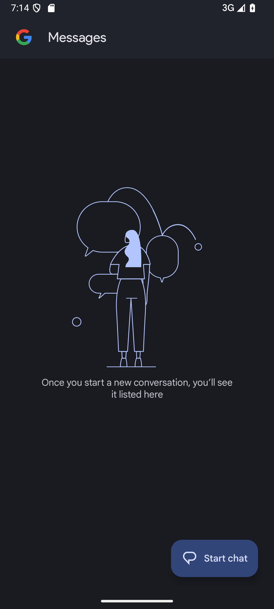 |

| Prayer Log & Tracker | Prayer Guidance | Sunnah Guidance | Architecture & Info |
| :---: | :---: | :---: | :---: |
| 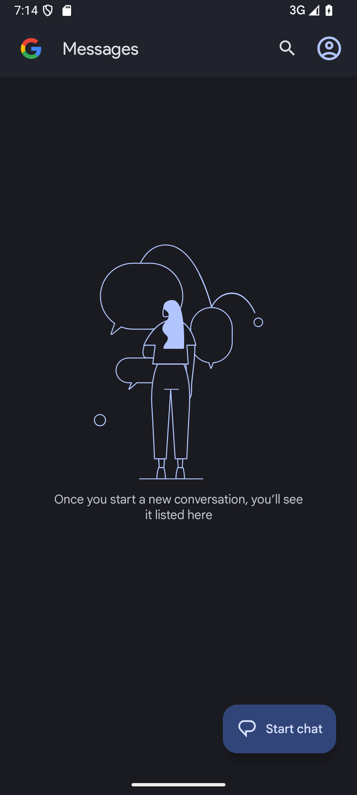 | 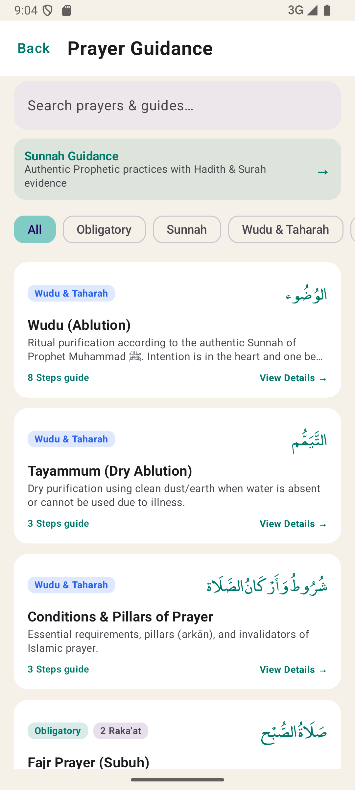 | 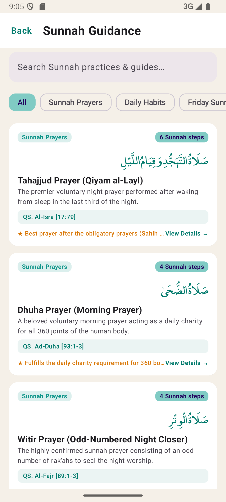 | 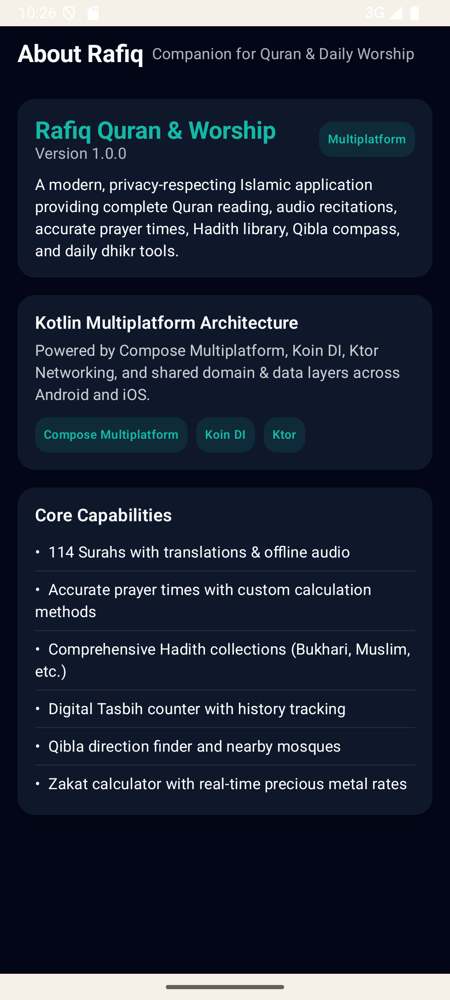 |

---

## 🌟 Key Features

| Feature | Description |
|---|---|
| **🕌 Prayer Times** | Real-time prayer calculation via Aladhan API with date navigation, countdown timer, and interactive prayer status cards. |
| **📖 Quran & Tafsir** | 114 Surahs with Uthmani Arabic text, Indonesian/English translations, per-ayah tafsir, sajdah markers, memorization mode, and global ayah search across the full corpus. |
| **🔊 Recitations** | Audio streaming of 15 reciters via Media3 ExoPlayer with background playback. |
| **🧭 Qibla Compass** | 16-point direction name, live heading/bearing readout, turn left/right offset indicator (proximity within 5°), Kaaba info card, and a Google Maps button. |
| **✨ Asmaul Husna (99 Names of Allah)** | Complete list with Arabic typography, transliterations, meanings, audio, search functionality, and grid/list view toggle. |
| **📅 Islamic Calendar (`IslamicCalendar`)** | Tabular Hijri dates, monthly grid with event/fasting dots, day sheet, upcoming observances (57 events), and sunnah fasting recommendations. Available in native Android and Compose Multiplatform. |
| **📜 Prophet Stories** | Biographies of 25 Prophets with facts, key events, lessons, and verse references; Arabic/Latin search, favorites filter, share, adjustable story font size, and prev/next navigation. |
| **📚 Hadith Library** | Full canonical corpus (Sahih Bukhari, Sahih Muslim, 40 Hadith Nawawi, Sunan Abi Dawud, etc.) with book filtering, thematic topic explorer, Hadith of the Day, and reading modal with adjustable typography. |
| **💰 Zakat Calculator (`ZakatCalculator`)** | Nisab threshold logic with instant results computed locally while gold/silver prices refresh in the background from the Metals.live API (in-memory cache). |
| **📿 Tasbih Counter & History (`TasbihHistory`)** | Digital zikr counter with responsive spring haptics, tactile compression, customizable targets, preset zikr selections, and daily worship history log. |
| **🗺️ Nearby Mosques** | Location-aware MapLibre view (no Play Services) with nearby mosque discovery via a reliable Overpass POST API with mirror failover. |
| **📖 Prayer Guidance** | Step-by-step guidance for obligatory prayers (Subuh, Dzuhur, Ashar, Maghrib, Isya) with authentic hadith/verse dalil, Arabic recitation, translation, and movement illustrations. |
| **🤲 Sunnah Guidance** | Comprehensive guide for recommended prayers (Tahajjud, Dhuha, Rawatib, Witr, Eid, etc.) with procedures, intentions, and virtues. |
| **📊 Prayer Tracker & Log (`PrayerLog`)** | Daily prayer tracker with intuitive completion toggles and statistics to build consistent daily worship habits. |
| **🔖 Bookmarked Verses** | Bookmark favorite verses saved locally in Room database for quick offline access. |
| **🧠 Hifz Memorization** | Memorization tracking tools for memorizing verses and chapters with hide/reveal assistance. |
| **ℹ️ App & Architecture Info** | Shared multiplatform system overview, KMP layer information, and release details. |
| **📚 Sources & Authenticity** | Full attribution and authenticity details for Quranic text, translations, hadith collections, and prayer time calculations. |
| **🔔 Notifications** | Background prayer alarm notifications scheduled via WorkManager. |
| **⚙️ Settings & Updates** | Language preference (Bahasa Indonesia / English), theme mode, dashboard customization, and in-app update checking via GitHub Releases & Google Play. |

---

## 🛠️ Tech Stack & Open-Source Libraries

### Architecture & Multiplatform Core
- **[Kotlin Multiplatform](https://kotlinlang.org/docs/multiplatform.html)** (2.1.20): Shared business logic and common codebase targeting Android and iOS.
- **[Android Gradle Plugin](https://developer.android.com/build)** (8.9.2): Modern Android build pipeline.
- **[Coroutines](https://github.com/Kotlin/kotlinx.coroutines)** + **[Flow](https://kotlin.github.io/kotlinx.coroutines/kotlinx-coroutines-core/kotlinx.coroutines.flow/)**: Asynchronous and reactive programming streams.
- **[Koin Multiplatform](https://insert-koin.io/)** (4.0.2): Multiplatform dependency injection across common, Android, and iOS targets.
- **[Hilt](https://dagger.dev/hilt/)** (2.56.2): Android dependency injection framework (KAPT).
- **[Navigation3](https://developer.android.com/guide/navigation)**: Type-safe Compose navigation using Kotlin `@Serializable` data tokens.
- **MVVM Architecture + Repository Pattern**: Separation of concerns between UI, Domain, and Data layers.

### UI & Styling (Design Engineering)
- **[Compose Multiplatform](https://www.jetbrains.com/lp/compose-multiplatform/)** (1.7.3): Declarative multiplatform UI framework for Android and iOS (`:composeApp`).
- **[Jetpack Compose](https://developer.android.com/jetpack/compose)**: Modern declarative UI toolkit for Android (`:app`).
- **[Material Design 3](https://m3.material.io/)**: Modern design system, dynamic color schemes, and Islamic emerald & gold palette.
- **Emil Kowalski Design Principles**: Tactile interaction physics via `Modifier.rafiqPressable()` with spring dynamics (`dampingRatio = 0.75f`, `stiffness = 400f`), Apple cubic bezier easing (`AppleEaseOut`), continuous curvature geometry (squircle pills & cards), and specular highlight borders (`RafiqSpecularHighlightBorder`).
- **Custom Typography**: Arabic font support via `FontFamily(Font(R.font.me_quran))` and negative title letter tracking for refined optical balance.

### Data & Local Storage
- **[Room Database KMP](https://developer.android.com/training/data-storage/room)** (2.8.4): SQLite object mapping library with Bundled SQLite Driver.
- **[DataStore Preferences](https://developer.android.com/topic/libraries/architecture/datastore)**: Multiplatform type-safe key-value data storage.

### Network & Media
- **[Ktor Client](https://ktor.io/)** (3.1.1): Multiplatform asynchronous HTTP client with `kotlinx.serialization`.
- **[Retrofit2](https://github.com/square/retrofit) & Gson**: Type-safe REST clients for Prayer Times, Tafsir, and Metals spot prices.
- **[OkHttp](https://square.github.io/okhttp/)**: HTTP client with logging interceptor.
- **[Media3 ExoPlayer](https://developer.android.com/guide/topics/media/media3)**: Audio playback engine for streaming recitations.
- **[Google Play Services Location](https://developers.google.com/android/reference/com/google/android/gms/location/package-summary)**: Fused location provider for nearby mosques.
- **[MapLibre Native](https://maplibre.org/)** (13.5.1): MapLibre rendering with GeoJson clustering for nearby mosques (BSD-2, no API key/billing).
- **[Firebase Crashlytics](https://firebase.google.com/docs/crashlytics)** (BoM 34.4.0): Crash reporting for release/staging builds.
- **[WorkManager](https://developer.android.com/topic/libraries/architecture/workmanager)**: Deferrable background task management for notifications.

---

## 🏗️ Architecture & Modularization

Rafiq follows **Clean Architecture** and Google's recommended [Guide to app architecture](https://developer.android.com/topic/architecture) with a **Kotlin Multiplatform (KMP)** multi-module layout.

### Multi-Module Structure

```
rafiq-android/
├── :app          # Application module (Android UI screens, ViewModels, Navigation, Services)
├── :composeApp   # Multiplatform UI & Platform bridges (Compose Multiplatform, shared components, iOS entry point)
├── :data         # Data layer (Room DAOs, Databases, Ktor/Retrofit APIs, DataStore, Repository Impls)
├── :domain       # Pure Kotlin Multiplatform domain layer (Repository interfaces, Use cases, Domain models)
├── :core         # Pure Kotlin Multiplatform core layer (Result pattern, AppError, DispatcherProvider, DatabaseCopier)
└── iosApp/       # Native iOS application wrapper (SwiftUI lifecycle, AppDelegate, Info.plist)
```

### Layer Architecture Overview

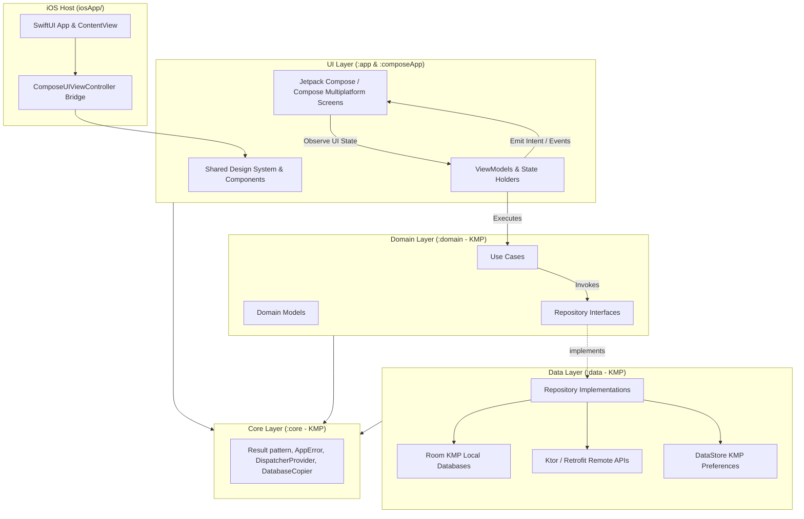

### Architecture Highlights
- **Kotlin Multiplatform Ready**: Pure KMP in `:core`, `:domain`, and `:composeApp`, supporting Android and iOS targets (`iosArm64`, `iosSimulatorArm64`). Shared multiplatform UI covers Quran, Hadith, Calendar, Tasbih, Asmaul Husna, Prophets, Zakat, and Guidance.
- **Offline-First**: Bundled SQLite database assets (`quran-uthmani.db`, translation databases, and `hadith.db`) ensure complete offline Quran and Hadith reading without requiring an initial network load.
- **Single Source of Truth**: Repositories manage caching between remote APIs and local databases.
- **Unidirectional Data Flow (UDF)**: ViewModels expose immutable `StateFlow<UiState>` to Compose UI elements while handling events asynchronously via Coroutines.

---

## 🌐 Data Sources & APIs

- **Quran Text & Translation**: Bundled SQLite databases (`quran-uthmani.db`, `translations/en.sahih.db`, `translations/id.indonesian.db`) via `DatabaseCopier`.
- **Hadith Corpus**: Bundled SQLite database (`hadith.db`) with the full Sahih Bukhari and Sahih Muslim corpus in Arabic with Indonesian/English translations.
- **Tafsir**: [EQuran.id API](https://equran.id/) (`api/v2/tafsir/{surah}`) for Indonesian tafsir and [IslamicApp API](https://api.islamic.app/) (`v1/verses/by_key/{sura}:{aya}`) for English tafsir (Ibn Kathir).
- **Prayer Timings API**: [Aladhan REST API](https://aladhan.com/prayer-times-api) (`v1/timings/{date}`).
- **Zakat Gold/Silver Spot Prices**: [Metals.live API](https://metals.live/) (`v1/spot/gold`, `v1/spot/silver`).
- **Nearby Mosques**: [Overpass API](https://overpass-api.de/) (POST query body) with mirror failover across `overpass-api.de`, `overpass.kumi.systems`, and `maps.mail.ru`.
- **Maps**: MapLibre Native with vector style `https://demotiles.maplibre.org/styles/osm-bright-gl-style/style.json` (clustering via `GeoJsonSource` + `SymbolLayer`).
- **Static Content**: JSON assets for 99 Names, Islamic events, prophets, dzikir/tasbih, reciters, chapters, and juz metadata.

---

## 🚀 Building & Setup

### Prerequisites
- **Android Studio** Ladybug (2024.2+) or newer
- **JDK**: 17+
- **Android SDK**: 36 (minSdk 23, targetSdk 36)
- **Xcode** (for iOS build): 15+ (macOS runner)
- **Environment**: Set `JAVA_HOME` pointing to JDK / Android Studio JBR.

### Build APK

```powershell
# Set JAVA_HOME (Windows PowerShell example; Temurin JDK 17 recommended)
$env:JAVA_HOME = "C:\Program Files\Eclipse Adoptium\jdk-17.0.19.10-hotspot"

# Build debug APK
.\gradlew assembleDebug
```

The compiled APK will be located at:
`app/build/outputs/apk/debug/app-debug.apk`

Install on the emulator:

```powershell
adb -s emulator-5554 install -r app\build\outputs\apk\debug\app-debug.apk
```

### Running Tests

```powershell
.\gradlew testDebugUnitTest         # Run multi-module unit tests (JVM / Android)
.\gradlew :composeApp:testDebugUnitTest # Run Compose Multiplatform tests
```

---

## 📄 License

```
Copyright 2026 Rafiq Android Team

Licensed under the Apache License, Version 2.0 (the "License");
you may not use this file except in compliance with the License.
You may obtain a copy of the License at

    http://www.apache.org/licenses/LICENSE-2.0

Unless required by applicable law or agreed to in writing, software
distributed under the License is distributed on an "AS IS" BASIS,
WITHOUT WARRANTIES OR CONDITIONS OF ANY KIND, either express or implied.
See the License for the specific language governing permissions and
limitations under the License.
```
