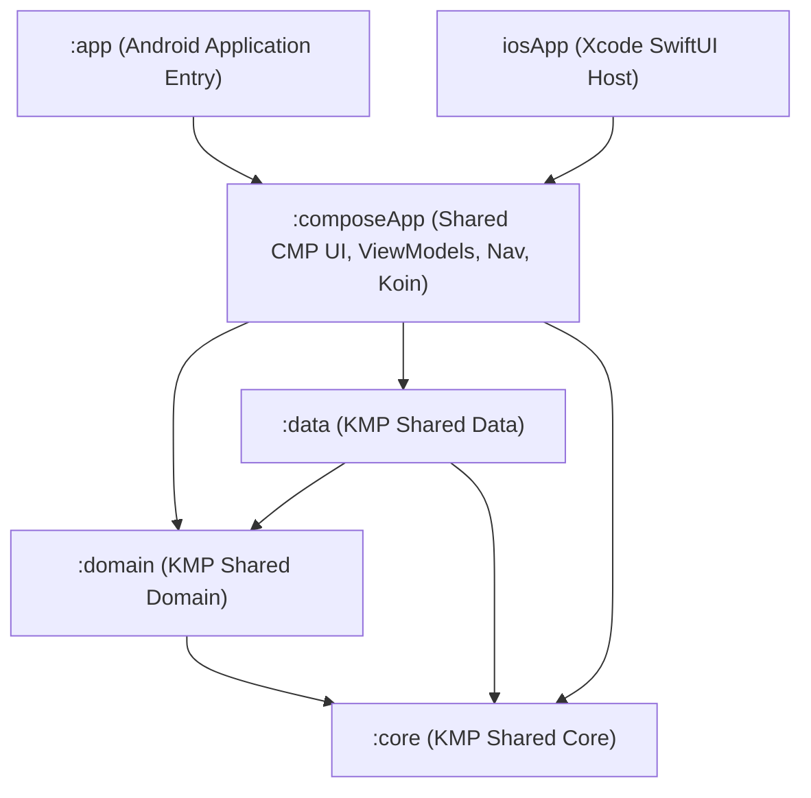

# Kotlin Multiplatform (KMP) & Compose Multiplatform Migration Plan — Rafiq App

## Overview

Migrate **Rafiq App** from an Android-only multi-module project (`:core`, `:domain`, `:data`, `:app`) to a **full Kotlin Multiplatform (KMP) + Compose Multiplatform (CMP)** architecture targeting **Android** and **iOS** (`iosArm64`, `iosSimulatorArm64`).

This plan preserves existing clean architecture boundaries, offline-first SQLite assets (`quran-uthmani.db`, `hadith.db`, translation DBs), Material 3 Islamic theming, and reactive unidirectional data flow (`ViewModel` + `StateFlow<UiState>`), while replacing JVM/Android-locked dependencies (Hilt/KAPT, Retrofit/OkHttp/Gson, `android.database.sqlite.SQLiteDatabase`, `java.util.*`, `org.json.*`, `R.string.*`) with first-class KMP equivalents.

---

## Current vs. Target Architecture

### Current State Audit

| Module | Current Plugin | Android/JVM Coupling Identified |
|---|---|---|
| **`:core`** | `org.jetbrains.kotlin.jvm` | [`LocaleUtil.kt`](file:///C:/Users/groun/.t3/worktrees/rafiq-app-android/t3-5b7eda7c/core/src/main/kotlin/com/smiledev/rafiq_quran/core/LocaleUtil.kt) uses `java.util.Locale`. [`DispatcherProvider.kt`](file:///C:/Users/groun/.t3/worktrees/rafiq-app-android/t3-5b7eda7c/core/src/main/kotlin/com/smiledev/rafiq_quran/core/DispatcherProvider.kt), [`Result.kt`](file:///C:/Users/groun/.t3/worktrees/rafiq-app-android/t3-5b7eda7c/core/src/main/kotlin/com/smiledev/rafiq_quran/core/Result.kt), [`AppError.kt`](file:///C:/Users/groun/.t3/worktrees/rafiq-app-android/t3-5b7eda7c/core/src/main/kotlin/com/smiledev/rafiq_quran/core/AppError.kt), [`retryIO.kt`](file:///C:/Users/groun/.t3/worktrees/rafiq-app-android/t3-5b7eda7c/core/src/main/kotlin/com/smiledev/rafiq_quran/core/retryIO.kt) are pure Kotlin. |
| **`:domain`** | `org.jetbrains.kotlin.jvm` | 99% pure Kotlin! Only [`TodayProvider.kt`](file:///C:/Users/groun/.t3/worktrees/rafiq-app-android/t3-5b7eda7c/domain/src/main/kotlin/com/smiledev/rafiq_quran/domain/util/TodayProvider.kt) imports `java.util.Calendar`. [`HijriDateConverter.kt`](file:///C:/Users/groun/.t3/worktrees/rafiq-app-android/t3-5b7eda7c/domain/src/main/kotlin/com/smiledev/rafiq_quran/domain/util/HijriDateConverter.kt) and all 20 models, 18 repository interfaces, and 12 use cases are pure Kotlin. |
| **`:data`** | `com.android.library`, `kotlin.android`, `kapt`, `hilt` | Uses **Hilt** (`@Inject`, `@Singleton`, `@ApplicationContext`), **Retrofit + OkHttp + Gson** (6 API services), **Room** (4 user DBs: `BookmarkDatabase`, `HifzDatabase`, `PrayerLogDatabase`, `TasbihDatabase`), **Android `SQLiteDatabase`** (`QuranRepositoryImpl`, `HadithRepositoryImpl`, `DatabaseCopier`), **`org.json.JSONObject`** & `context.assets.open(...)` (8 JSON asset repositories), **DataStore** (`PreferencesManager` with `Context.dataStore` + `Gson`), and **Play Services Location** (`LocationProviderImpl`). |
| **`:app`** | `com.android.application`, `kotlin.android`, `compose.compiler`, `kapt`, `hilt` | Uses **Hilt** (`@HiltViewModel`, `hiltViewModel()`, [`AppModule.kt`](file:///C:/Users/groun/.t3/worktrees/rafiq-app-android/t3-5b7eda7c/app/src/main/java/com/smiledev/rafiq_quran/di/AppModule.kt)), **AndroidX Navigation 3** ([`Navigation.kt`](file:///C:/Users/groun/.t3/worktrees/rafiq-app-android/t3-5b7eda7c/app/src/main/java/com/smiledev/rafiq_quran/Navigation.kt)), **Android Resources** (`R.string.*`, `R.drawable.*`, `R.font.me_quran`), **Media3 ExoPlayer** (`AudioPlayerController`, `AudioRecitationService`), **MapLibre Android SDK** (`MosquesScreen`), **SensorManager** (`QiblaScreen`), **WorkManager + AlarmManager** (`PrayerNotificationWorker`, `PrayerAlarmReceiver`), and **Vibrator / ToneGenerator** (`TasbihScreen`). |

### Target Technology Stack Mapping

| Layer / Concern | Current (Android-only) | Target (KMP Android + iOS) |
|---|---|---|
| **Build & Compiler** | Kotlin `2.1.20`, AGP `8.9.2`, KAPT | Kotlin `2.1.20` (`kotlin-multiplatform`), AGP `8.9.2`, **KSP** (`2.1.20-1.0.31`), Compose Multiplatform `1.8.0+` |
| **Dependency Injection** | Dagger Hilt `2.56.2` + `hilt-navigation-compose` | **Koin `4.0.2`** (`koin-core`, `koin-compose`, `koin-compose-viewmodel`, `koin-android`) |
| **Networking** | Retrofit `2.11.0` + OkHttp `4.12.0` + Gson `2.11.0` | **Ktor Client `3.1.1`** (`ktor-client-core`, `ktor-client-content-negotiation`, `ktor-serialization-kotlinx-json`, `ktor-client-okhttp` on Android, `ktor-client-darwin` on iOS) |
| **JSON Serialization** | `com.google.code.gson:gson` + `org.json.JSONObject` | **`kotlinx-serialization-json` `1.8.0`** |
| **User Databases (4 DBs)** | Room `2.8.4` (KAPT, Android `SupportSQLiteOpenHelper`) | **Room KMP `2.8.4`** (`androidx.room.gradle.plugin` + KSP `room-compiler`) + **`androidx.sqlite:sqlite-bundled:2.5.0`** (`BundledSQLiteDriver`) |
| **Read-Only Asset SQLite (`quran-uthmani.db`, `hadith.db`, `translations/*.db`)** | `android.database.sqlite.SQLiteDatabase` + `DatabaseCopier` | **`BundledSQLiteDriver`** (`androidx.sqlite.driver.bundled.BundledSQLiteDriver` + `SQLiteConnection.prepare(...)`) + KMP `DatabaseCopier` using **`kotlinx-io` / `okio`** |
| **Preferences** | `androidx.datastore:datastore-preferences:1.1.1` (`Context.dataStore` delegate) | **DataStore KMP `1.1.3`** (`PreferenceDataStoreFactory.createWithPath` using Okio `Path`) |
| **Date & Time** | `java.util.Calendar`, `java.text.SimpleDateFormat`, `System.currentTimeMillis()` | **`kotlinx-datetime` `0.6.2`** (`Clock.System`, `LocalDate`, `TimeZone.currentSystemDefault()`) |
| **UI & Resources** | Jetpack Compose + Android `R.string` / `R.drawable` / `R.font` | **Compose Multiplatform** + **`compose.components.resources`** (`Res.string.*`, `Res.drawable.*`, `Res.font.me_quran`, `Res.readBytes("files/quran-data/...")`) |
| **ViewModels & Lifecycle** | `androidx.lifecycle:lifecycle-viewmodel-compose:2.10.0` | **JetBrains Multiplatform Lifecycle `2.8.4+` / `2.9.0`** (`org.jetbrains.androidx.lifecycle:lifecycle-viewmodel-compose`, `lifecycle-runtime-compose`) |
| **Navigation** | `androidx.navigation3` (`1.0.1`) | **JetBrains Navigation Compose Multiplatform** (`org.jetbrains.androidx.navigation:navigation-compose:2.8.0-alpha12+`) or shared `NavKey` backstack state holder (preserving `@Serializable` routes in [`NavigationKeys.kt`](file:///C:/Users/groun/.t3/worktrees/rafiq-app-android/t3-5b7eda7c/app/src/main/java/com/smiledev/rafiq_quran/NavigationKeys.kt)) |
| **Unit Testing** | JUnit 4 + MockK + Robolectric | **`kotlin.test`** + **`kotlinx-coroutines-test`** + **`ktor-client-mock`** + Fake/In-Memory implementations + **Mokkery** (KMP mock library replacing JVM-only MockK) |

### Target Module Dependency Graph



> [!IMPORTANT]
> Keeping `:app` as a thin Android application module (or having `:composeApp` provide the shared UI library consumed by `:app` and `iosApp`) guarantees existing Android Gradle tasks (`assembleDebug`, `testDebug`, `connectedDebugAndroidTest`) and APK signing/splits remain intact without breaking CI/CD workflows.

---

## Phased Implementation Plan

---

### Phase 1: Gradle Build System, Version Catalog & KMP Scaffolding

**Goal:** Configure Kotlin Multiplatform, Compose Multiplatform, KSP, and Room Gradle plugins in [`gradle/libs.versions.toml`](file:///C:/Users/groun/.t3/worktrees/rafiq-app-android/t3-5b7eda7c/gradle/libs.versions.toml) and [`build.gradle.kts`](file:///C:/Users/groun/.t3/worktrees/rafiq-app-android/t3-5b7eda7c/build.gradle.kts) without breaking the current Android build.

#### 1.1 Update [`gradle/libs.versions.toml`](file:///C:/Users/groun/.t3/worktrees/rafiq-app-android/t3-5b7eda7c/gradle/libs.versions.toml)
- Add versions:
  - `composeMultiplatform = "1.8.0"` (compatible with Kotlin `2.1.20`)
  - `ksp = "2.1.20-1.0.31"`
  - `ktor = "3.1.1"`
  - `koin = "4.0.2"`
  - `kotlinxDatetime = "0.6.2"`
  - `sqliteBundled = "2.5.0"`
  - `okio = "3.10.2"`
  - `jetbrainsLifecycle = "2.8.4"`
  - `jetbrainsNavigation = "2.8.0-alpha12"`
- Add plugins:
  - `kotlin-multiplatform = { id = "org.jetbrains.kotlin.multiplatform", version.ref = "kotlin" }`
  - `compose-multiplatform = { id = "org.jetbrains.compose", version.ref = "composeMultiplatform" }`
  - `ksp = { id = "com.google.devtools.ksp", version.ref = "ksp" }`
  - `room = { id = "androidx.room", version.ref = "room" }`
- Add library entries for Ktor (`ktor-client-core`, `ktor-client-okhttp`, `ktor-client-darwin`, `ktor-client-content-negotiation`, `ktor-serialization-kotlinx-json`, `ktor-client-logging`, `ktor-client-mock`), Koin (`koin-core`, `koin-android`, `koin-compose`, `koin-compose-viewmodel`), `kotlinx-datetime`, `androidx-sqlite-bundled`, and `okio`.

#### 1.2 Update [`settings.gradle.kts`](file:///C:/Users/groun/.t3/worktrees/rafiq-app-android/t3-5b7eda7c/settings.gradle.kts)
- Expand `google()` repository `content` filter or remove overly restrictive `includeGroupByRegex` rules if they block JetBrains Compose / KMP artifacts.
- Include `:composeApp` (or configure `:core`, `:domain`, `:data`, `:composeApp`, `:app`).

#### 1.3 Verification Gate
- Run `./gradlew help` and `./gradlew assembleDebug` to confirm Gradle plugin resolution succeeds with JDK 17.

---

### Phase 2: Migrate `:core` and `:domain` to Pure KMP (`commonMain`)

**Goal:** Convert `:core` and `:domain` from `org.jetbrains.kotlin.jvm` to `org.jetbrains.kotlin.multiplatform` targeting `androidTarget()` (or `jvm()`) and `iosArm64()`, `iosSimulatorArm64()`.

#### 2.1 Migrate `:core` ([`core/build.gradle.kts`](file:///C:/Users/groun/.t3/worktrees/rafiq-app-android/t3-5b7eda7c/core/build.gradle.kts))
- Apply `alias(libs.plugins.kotlin.multiplatform)` and `alias(libs.plugins.android.library)`.
- Move `core/src/main/kotlin/...` to `core/src/commonMain/kotlin/...`.
- Refactor [`LocaleUtil.kt`](file:///C:/Users/groun/.t3/worktrees/rafiq-app-android/t3-5b7eda7c/core/src/main/kotlin/com/smiledev/rafiq_quran/core/LocaleUtil.kt):
  - Replace `java.util.Locale.getDefault().language` with `expect fun currentLocaleCode(): String` in `commonMain`:
    - **`androidMain`**: `Locale.getDefault().language.let { if (it == "id" || it == "in") "id" else "en" }`
    - **`iosMain`**: `NSLocale.preferredLanguages.firstOrNull()?.toString()?.take(2).let { if (it == "id" || it == "in") "id" else "en" }`
- Refactor [`DispatcherProvider.kt`](file:///C:/Users/groun/.t3/worktrees/rafiq-app-android/t3-5b7eda7c/core/src/main/kotlin/com/smiledev/rafiq_quran/core/DispatcherProvider.kt):
  - `kotlinx.coroutines.Dispatchers.IO` is available in `kotlinx-coroutines-core` `1.10.2` across both Android and iOS (`kotlinx.coroutines.IO`), so `DefaultDispatcherProvider` remains in `commonMain`.

#### 2.2 Migrate `:domain` ([`domain/build.gradle.kts`](file:///C:/Users/groun/.t3/worktrees/rafiq-app-android/t3-5b7eda7c/domain/build.gradle.kts))
- Apply `alias(libs.plugins.kotlin.multiplatform)` and `alias(libs.plugins.kotlin.serialization)`.
- Move `domain/src/main/kotlin/...` to `domain/src/commonMain/kotlin/...` and `domain/src/test/kotlin/...` to `domain/src/commonTest/kotlin/...`.
- Annotate domain models needed for caching (`PrayerTimesData`, `PrayerTimings`, `HijriDateInfo`, `HijriMonth`, `GregorianDateInfo`, etc. in [`PrayerTimings.kt`](file:///C:/Users/groun/.t3/worktrees/rafiq-app-android/t3-5b7eda7c/domain/src/main/kotlin/com/smiledev/rafiq_quran/domain/model/PrayerTimings.kt)) with `@Serializable`.
- Refactor [`TodayProvider.kt`](file:///C:/Users/groun/.t3/worktrees/rafiq-app-android/t3-5b7eda7c/domain/src/main/kotlin/com/smiledev/rafiq_quran/domain/util/TodayProvider.kt):
  - Replace `java.util.Calendar` with `kotlinx.datetime`:
    ```kotlin
    object SystemTodayProvider : TodayProvider {
        override fun today(): GregorianDate {
            val now = Clock.System.todayIn(TimeZone.currentSystemDefault())
            return GregorianDate(now.year, now.monthNumber, now.dayOfMonth)
        }
    }
    ```
  - Also add `fun dayOfYear(): Int` to `TodayProvider` (using `Clock.System.todayIn(TimeZone.currentSystemDefault()).dayOfYear`) so [`HadithRepositoryImpl.getHadithOfTheDay`](file:///C:/Users/groun/.t3/worktrees/rafiq-app-android/t3-5b7eda7c/data/src/main/kotlin/com/smiledev/rafiq_quran/data/repository/HadithRepositoryImpl.kt#L118-L120) no longer needs `java.util.Calendar`.
- Migrate domain unit tests in `domain/src/commonTest` from JUnit4/MockK to `kotlin.test` (`@Test`, `assertEquals`, `assertTrue`) and lightweight fake implementations of repository interfaces (since `:domain` interfaces are simple 1–3 method contracts, fakes are cleaner and faster than mocking frameworks in `commonTest`).

#### 2.3 Verification Gate
- Run `./gradlew :core:allTests :domain:allTests` to verify `commonMain` and `commonTest` compile and pass.

---

### Phase 3: Migrate `:data` to KMP (Networking, Room KMP, Asset SQLite, DataStore)

**Goal:** Convert `:data` into a KMP module (`commonMain`, `androidMain`, `iosMain`) with shared networking, databases, preferences, and offline asset readers.

#### 3.1 Networking: Retrofit + OkHttp + Gson $\rightarrow$ Ktor + `kotlinx.serialization`
Migrate all 6 remote API services in `data/src/commonMain/kotlin/com/smiledev/rafiq_quran/data/remote/`:
1. **[`AladhanApi.kt`](file:///C:/Users/groun/.t3/worktrees/rafiq-app-android/t3-5b7eda7c/data/src/main/kotlin/com/smiledev/rafiq_quran/data/remote/AladhanApi.kt)**: Replace `@GET("v1/timings/{date}")` and `@SerializedName` with Ktor `httpClient.get("https://api.aladhan.com/v1/timings/$date") { parameter("latitude", ...); ... }.body<AladhanResponse>()` and `@SerialName` + `@Serializable`.
2. **[`EQuranApi.kt`](file:///C:/Users/groun/.t3/worktrees/rafiq-app-android/t3-5b7eda7c/data/src/main/kotlin/com/smiledev/rafiq_quran/data/remote/EQuranApi.kt)**: Replace Retrofit with Ktor `GET https://equran.id/api/v2/surat/$nomor` and `@Serializable` DTOs.
3. **[`IslamicAppApi.kt`](file:///C:/Users/groun/.t3/worktrees/rafiq-app-android/t3-5b7eda7c/data/src/main/kotlin/com/smiledev/rafiq_quran/data/remote/IslamicAppApi.kt)**: Replace Retrofit with Ktor `GET https://api.islamic.app/...` and `@Serializable` DTOs.
4. **[`MetalPriceApi.kt`](file:///C:/Users/groun/.t3/worktrees/rafiq-app-android/t3-5b7eda7c/data/src/main/kotlin/com/smiledev/rafiq_quran/data/remote/MetalPriceApi.kt)**: Replace Retrofit with Ktor client configured with 5s timeout (`timeout { requestTimeoutMillis = 5000 }`).
5. **[`OverpassApi.kt`](file:///C:/Users/groun/.t3/worktrees/rafiq-app-android/t3-5b7eda7c/data/src/main/kotlin/com/smiledev/rafiq_quran/data/remote/OverpassApi.kt)**: Keep the multi-mirror fallback logic (`overpass-api.de`, `overpass.kumi.systems`, `maps.mail.ru`) using Ktor `submitForm` / `get` across the base URLs.
6. **[`GithubReleaseApi.kt`](file:///C:/Users/groun/.t3/worktrees/rafiq-app-android/t3-5b7eda7c/data/src/main/kotlin/com/smiledev/rafiq_quran/data/remote/GithubReleaseApi.kt)**: Replace Retrofit with Ktor `GET https://api.github.com/repos/.../releases/latest`.
7. **Platform Engines**:
   - `expect fun createPlatformHttpClientEngine(): HttpClientEngine`
   - `androidMain`: `OkHttp.create()`
   - `iosMain`: `Darwin.create()`

#### 3.2 User Databases: Room Android (KAPT) $\rightarrow$ Room KMP (KSP + `BundledSQLiteDriver`)
Migrate the 4 Room databases in `data/src/commonMain/kotlin/com/smiledev/rafiq_quran/data/local/`:
- **[`BookmarkDatabase.kt`](file:///C:/Users/groun/.t3/worktrees/rafiq-app-android/t3-5b7eda7c/data/src/main/kotlin/com/smiledev/rafiq_quran/data/local/BookmarkDatabase.kt)**
- **[`HifzDatabase.kt`](file:///C:/Users/groun/.t3/worktrees/rafiq-app-android/t3-5b7eda7c/data/src/main/kotlin/com/smiledev/rafiq_quran/data/local/HifzDatabase.kt)**
- **[`PrayerLogDatabase.kt`](file:///C:/Users/groun/.t3/worktrees/rafiq-app-android/t3-5b7eda7c/data/src/main/kotlin/com/smiledev/rafiq_quran/data/local/PrayerLogDatabase.kt)**
- **[`TasbihDatabase.kt`](file:///C:/Users/groun/.t3/worktrees/rafiq-app-android/t3-5b7eda7c/data/src/main/kotlin/com/smiledev/rafiq_quran/data/local/TasbihDatabase.kt)**

**Changes Required:**
1. Add `@ConstructedBy(XxxDatabaseConstructor::class)` to each `@Database` class in `commonMain`, alongside `expect object XxxDatabaseConstructor : RoomDatabaseConstructor<XxxDatabase>`.
2. Remove `Context` and `synchronized` singletons from inside the `@Database` companion objects; instead expose a `RoomDatabase.Builder<T>` factory via `expect/actual`:
   - `androidMain`: `Room.databaseBuilder<T>(context, dbFile.absolutePath)`
   - `iosMain`: `Room.databaseBuilder<T>(name = dbFilePath)` using `NSDocumentDirectory`
3. Configure `.setDriver(BundledSQLiteDriver())` and `.setQueryCoroutineContext(Dispatchers.IO)` in shared database initialization.
4. Configure KSP in `data/build.gradle.kts`:
   ```kotlin
   dependencies {
       add("kspAndroid", libs.room.compiler)
       add("kspIosArm64", libs.room.compiler)
       add("kspIosSimulatorArm64", libs.room.compiler)
   }
   ```

#### 3.3 Read-Only Bundled Assets (JSON & Pre-Populated SQLite DBs)
Currently, `app/src/main/assets/quran-data/` holds JSON files and 4 SQLite databases (`quran-uthmani.db`, `hadiths/hadith.db`, `translations/en.sahih.db`, `translations/id.indonesian.db`).
1. **Asset Storage**:
   - Move `app/src/main/assets/quran-data/` into `composeApp/src/commonMain/composeResources/files/quran-data/` (or provide an `AssetReader` interface backed by `context.assets` on Android and `NSBundle.mainBundle` on iOS).
   - Creating a clean `interface AssetFileProvider` in `:core` or `:data` is strongly recommended for unit testability:
     ```kotlin
     interface AssetFileProvider {
         fun readText(relativePath: String): String
         fun copyAssetToFileIfNeeded(relativePath: String, destPath: String): Boolean
         fun getDatabasePath(flatName: String): String
     }
     ```
     - **`androidMain`**: Reads from `context.assets.open("quran-data/$relativePath")` and copies to `File(context.filesDir, "databases/$flatName")` (100% backward-compatible with existing Android installs!).
     - **`iosMain`**: Reads from `NSBundle.mainBundle.pathForResource(...)` (or Compose `files/quran-data/...`) and copies to `NSApplicationSupportDirectory/databases/$flatName`.
2. **JSON Parsing (`org.json.JSONObject` $\rightarrow$ `kotlinx.serialization.json.Json`)**:
   - Replace `org.json.JSONObject` / `JSONArray` in:
     - [`QuranRepositoryImpl.kt`](file:///C:/Users/groun/.t3/worktrees/rafiq-app-android/t3-5b7eda7c/data/src/main/kotlin/com/smiledev/rafiq_quran/data/repository/QuranRepositoryImpl.kt)
     - [`AsmaulHusnaRepositoryImpl.kt`](file:///C:/Users/groun/.t3/worktrees/rafiq-app-android/t3-5b7eda7c/data/src/main/kotlin/com/smiledev/rafiq_quran/data/repository/AsmaulHusnaRepositoryImpl.kt)
     - [`IslamicCalendarRepositoryImpl.kt`](file:///C:/Users/groun/.t3/worktrees/rafiq-app-android/t3-5b7eda7c/data/src/main/kotlin/com/smiledev/rafiq_quran/data/repository/IslamicCalendarRepositoryImpl.kt)
     - [`PrayerGuidanceRepositoryImpl.kt`](file:///C:/Users/groun/.t3/worktrees/rafiq-app-android/t3-5b7eda7c/data/src/main/kotlin/com/smiledev/rafiq_quran/data/repository/PrayerGuidanceRepositoryImpl.kt)
     - [`ProphetRepositoryImpl.kt`](file:///C:/Users/groun/.t3/worktrees/rafiq-app-android/t3-5b7eda7c/data/src/main/kotlin/com/smiledev/rafiq_quran/data/repository/ProphetRepositoryImpl.kt)
     - [`ReciterRepositoryImpl.kt`](file:///C:/Users/groun/.t3/worktrees/rafiq-app-android/t3-5b7eda7c/data/src/main/kotlin/com/smiledev/rafiq_quran/data/repository/ReciterRepositoryImpl.kt)
     - [`SunnahGuidanceRepositoryImpl.kt`](file:///C:/Users/groun/.t3/worktrees/rafiq-app-android/t3-5b7eda7c/data/src/main/kotlin/com/smiledev/rafiq_quran/data/repository/SunnahGuidanceRepositoryImpl.kt)
     - [`TasbihRepositoryImpl.kt`](file:///C:/Users/groun/.t3/worktrees/rafiq-app-android/t3-5b7eda7c/data/src/main/kotlin/com/smiledev/rafiq_quran/data/repository/TasbihRepositoryImpl.kt)
3. **Read-Only SQLite Queries (`android.database.sqlite.SQLiteDatabase` $\rightarrow$ `BundledSQLiteDriver`)**:
   - In [`DatabaseCopier.kt`](file:///C:/Users/groun/.t3/worktrees/rafiq-app-android/t3-5b7eda7c/data/src/main/kotlin/com/smiledev/rafiq_quran/core/DatabaseCopier.kt), [`QuranRepositoryImpl.kt`](file:///C:/Users/groun/.t3/worktrees/rafiq-app-android/t3-5b7eda7c/data/src/main/kotlin/com/smiledev/rafiq_quran/data/repository/QuranRepositoryImpl.kt), and [`HadithRepositoryImpl.kt`](file:///C:/Users/groun/.t3/worktrees/rafiq-app-android/t3-5b7eda7c/data/src/main/kotlin/com/smiledev/rafiq_quran/data/repository/HadithRepositoryImpl.kt), replace `SQLiteDatabase.openDatabase(...)` and `Cursor` with `BundledSQLiteDriver().open(dbPath)` (`androidx.sqlite.SQLiteConnection`):
     ```kotlin
     connection.prepare("SELECT sura, aya, text, bismillah FROM quran WHERE sura = ? ORDER BY CAST(aya AS INTEGER) ASC").use { stmt ->
         stmt.bindText(1, suraNumber.toString())
         while (stmt.step()) {
             val sura = stmt.getText(0).toIntOrNull() ?: 0
             val aya = stmt.getText(1).toIntOrNull() ?: 0
             val text = stmt.getText(2)
             val bismillah = if (stmt.isNull(3)) null else stmt.getText(3)
             // ...
         }
     }
     ```
   - This runs identically on Android, iOS, and JVM tests (eliminating the need for Robolectric in `QuranRepositoryImplTest`, `HadithRepositoryImplTest`, and `DatabaseCopierTest`!).

#### 3.4 Preferences: DataStore KMP (`PreferencesManager`)
- Refactor [`PreferencesManager.kt`](file:///C:/Users/groun/.t3/worktrees/rafiq-app-android/t3-5b7eda7c/data/src/main/kotlin/com/smiledev/rafiq_quran/data/preferences/PreferencesManager.kt) to accept `DataStore<Preferences>` directly in its constructor (`class PreferencesManager(private val dataStore: DataStore<Preferences>)`).
- Replace `Gson` in `getCachedPrayerTimes()` / `saveCachedPrayerTimes()` with `kotlinx.serialization.json.Json.encodeToString` / `decodeFromString`.
- Provide platform `DataStore<Preferences>` creation via `PreferenceDataStoreFactory.createWithPath`:
  - **`androidMain`**: `context.filesDir.resolve("datastore/rafiq_settings.preferences_pb").absolutePath.toPath()` (matches the exact path used by `preferencesDataStore(name = "rafiq_settings")` so existing user settings are preserved!).
  - **`iosMain`**: `NSDocumentDirectory` + `"rafiq_settings.preferences_pb"`.

#### 3.5 Location Provider (`expect`/`actual` or Platform Interface)
- [`LocationProvider`](file:///C:/Users/groun/.t3/worktrees/rafiq-app-android/t3-5b7eda7c/domain/src/main/kotlin/com/smiledev/rafiq_quran/domain/repository/LocationProvider.kt) is already a clean interface in `:domain`!
- Move [`LocationProviderImpl.kt`](file:///C:/Users/groun/.t3/worktrees/rafiq-app-android/t3-5b7eda7c/data/src/main/kotlin/com/smiledev/rafiq_quran/data/repository/LocationProviderImpl.kt) (using Google Play Services `FusedLocationProviderClient`) to `data/src/androidMain/.../AndroidLocationProviderImpl.kt`.
- Create `IosLocationProviderImpl.kt` in `data/src/iosMain/...` using `CLLocationManager` + `CLLocationManagerDelegateProtocol` with fallback to `PreferencesManager` coordinates (`-6.2088, 106.8456`).

#### 3.6 Verification Gate
- Run `./gradlew :data:testDebugUnitTest` (and `iosSimulatorArm64Test` when on macOS) — all repository tests (`QuranRepositoryImplTest`, `HadithRepositoryImplTest`, `DatabaseCopierTest`, etc.) run in `commonTest` using `BundledSQLiteDriver` without needing Robolectric.

---

### Phase 4: Dependency Injection Migration (Dagger Hilt $\rightarrow$ Koin Multiplatform)

**Goal:** Replace Dagger Hilt and KAPT across `:data`, `:composeApp`, and `:app` with **Koin Multiplatform**.

#### 4.1 Create Shared Koin Modules (`commonMain`)
Replace [`AppModule.kt`](file:///C:/Users/groun/.t3/worktrees/rafiq-app-android/t3-5b7eda7c/app/src/main/java/com/smiledev/rafiq_quran/di/AppModule.kt) (`@Module`, `@InstallIn`, `@Binds`, `@Provides`) with modular Koin definitions:
1. **`platformModule: Module` (`expect val platformModule: Module`)**:
   - Provides platform-specific `AssetFileProvider`, `DataStore<Preferences>`, Room `DatabaseBuilder`s, `LocationProvider`, `AudioPlayerBridge`, `CompassSensorBridge`, `HapticFeedbackBridge`, `PrayerReminderScheduler`, and `ExternalMapLauncher`.
2. **`networkModule`**:
   - Provides `Json { ignoreUnknownKeys = true; isLenient = true }`, default `HttpClient` (30s timeout), `named("metalpriceClient")` `HttpClient` (5s timeout), and the 6 Ktor API services (`AladhanApiService`, `MetalPriceApiService`, `IslamicAppApiService`, `EQuranApiService`, `OverpassApi`, `GithubReleaseApiService`).
3. **`databaseModule`**:
   - Provides `DatabaseCopier`, `BookmarkDatabase`, `BookmarkDao`, `PrayerLogDatabase`, `PrayerLogDao`, `HifzDatabase`, `HifzDao`, `TasbihDatabase`, `TasbihDao`, `PreferencesManager`.
4. **`repositoryModule`**:
   - Binds all 18 repository implementations as `singleOf(::XxxRepositoryImpl) { bind<XxxRepository>() }`.
5. **`useCaseModule`**:
   - Provides all 12 use cases (`factoryOf` / `singleOf`).
6. **`viewModelModule`**:
   - Registers all 18 ViewModels using `viewModelOf(::XxxViewModel)` (and parameterized `viewModel { params -> ... }` where `SavedStateHandle` or route args are used).

#### 4.2 Remove `@HiltViewModel`, `@Inject`, and `kapt`
- Remove `@HiltViewModel` and `javax.inject.Inject` from all ViewModels and Repositories.
- Replace `hiltViewModel()` in all Composable screens with `koinViewModel()` from `org.koin.compose.viewmodel.koinViewModel`.
- Remove `alias(libs.plugins.kapt)` and `alias(libs.plugins.hilt)` from all `build.gradle.kts` files. (Eliminates KAPT Kotlin 1.9 fallback warnings completely!).

---

### Phase 5: Shared UI, Resources, ViewModels & Navigation (`:composeApp`)

**Goal:** Move the Compose UI layer, Design System, Theme, ViewModels, and Navigation into `composeApp/src/commonMain`.

#### 5.1 Multiplatform Compose Resources (`R.*` $\rightarrow$ `Res.*`)
- Move `app/src/main/res/values/strings.xml` and `app/src/main/res/values-in/strings.xml` (or `values-id`) to `composeApp/src/commonMain/composeResources/values/strings.xml` and `values-id/strings.xml`.
- Move all 38 vector drawables (`ic_quran.xml`, `ic_mosque.xml`, `ic_prayer_*.xml`, etc.) to `composeApp/src/commonMain/composeResources/drawable/`.
- Move `app/src/main/res/font/me_quran.ttf` to `composeApp/src/commonMain/composeResources/font/me_quran.ttf`.
- Configure in `composeApp/build.gradle.kts`:
  ```kotlin
  compose.resources {
      publicResClass = true
      packageOfResClass = "com.smiledev.rafiq_quran.resources"
      generateResClass = always
  }
  ```
- Update UI imports across screens and [`theme/ArabicTypography.kt`](file:///C:/Users/groun/.t3/worktrees/rafiq-app-android/t3-5b7eda7c/app/src/main/java/com/smiledev/rafiq_quran/theme/ArabicTypography.kt):
  - `androidx.compose.ui.res.stringResource(R.string.xxx)` $\rightarrow$ `org.jetbrains.compose.resources.stringResource(Res.string.xxx)`
  - `androidx.compose.ui.res.painterResource(R.drawable.xxx)` $\rightarrow$ `org.jetbrains.compose.resources.painterResource(Res.drawable.xxx)`
  - `Font(R.font.me_quran)` $\rightarrow$ `org.jetbrains.compose.resources.Font(Res.font.me_quran)`

#### 5.2 Theme & Dynamic Color Bridge
- Move `theme/` (`Color.kt`, `ExtendedColors.kt`, `RafiqTheme.kt`, `Shape.kt`, `Spacing.kt`, `Theme.kt`, `Type.kt`, `ArabicTypography.kt`) and `ui/designsystem/` to `commonMain`.
- In [`Theme.kt`](file:///C:/Users/groun/.t3/worktrees/rafiq-app-android/t3-5b7eda7c/app/src/main/java/com/smiledev/rafiq_quran/theme/Theme.kt), extract Android 12+ Material You dynamic color (`dynamicDarkColorScheme(context)` / `dynamicLightColorScheme(context)`) into:
  ```kotlin
  @Composable
  expect fun platformColorScheme(darkTheme: Boolean, dynamicColor: Boolean): ColorScheme?
  ```
  - **`androidMain`**: Returns `dynamicDarkColorScheme(LocalContext.current)` on API 31+ when `dynamicColor == true`, else `null` (falling back to Rafiq's Islamic Teal/Gold color scheme).
  - **`iosMain`**: Returns `null` (always uses Rafiq's signature Islamic Teal/Gold color scheme).

#### 5.3 Multiplatform ViewModels & State Management
- Move all 18 ViewModels (`DashboardViewModel`, `QuranViewModel`, `AyahViewModel`, `PrayerTimesViewModel`, `QiblaViewModel`, `MosquesViewModel`, `ProphetsViewModel`, `ProphetDetailViewModel`, `HadithViewModel`, `RecitationViewModel`, `CalendarViewModel`, `ZakatViewModel`, `AsmaulHusnaViewModel`, `TasbihViewModel`, `TasbihHistoryViewModel`, `BookmarkListViewModel`, `PrayerLogViewModel`, `PrayerGuidanceViewModel`, `SunnahGuidanceViewModel`, `HifzViewModel`, `SettingsViewModel`) to `commonMain`.
- Replace `java.util.Locale` / `String.format(...)` calls in UI/ViewModels (such as [`TimeFormat.kt`](file:///C:/Users/groun/.t3/worktrees/rafiq-app-android/t3-5b7eda7c/app/src/main/java/com/smiledev/rafiq_quran/ui/common/TimeFormat.kt), [`QiblaScreen.kt`](file:///C:/Users/groun/.t3/worktrees/rafiq-app-android/t3-5b7eda7c/app/src/main/java/com/smiledev/rafiq_quran/ui/qibla/QiblaScreen.kt), [`ZakatCalculatorScreen.kt`](file:///C:/Users/groun/.t3/worktrees/rafiq-app-android/t3-5b7eda7c/app/src/main/java/com/smiledev/rafiq_quran/ui/zakat/ZakatCalculatorScreen.kt)) with pure Kotlin formatting utilities in `:core` (`formatDecimal(value, decimals)`, `formatThousands(number)`).
- Replace `java.lang.Math.toDegrees` in [`QiblaScreen.kt`](file:///C:/Users/groun/.t3/worktrees/rafiq-app-android/t3-5b7eda7c/app/src/main/java/com/smiledev/rafiq_quran/ui/qibla/QiblaScreen.kt#L87) with `(azimuthRad * 180.0 / kotlin.math.PI).toFloat()`.

#### 5.4 Multiplatform Navigation
- Keep [`NavigationKeys.kt`](file:///C:/Users/groun/.t3/worktrees/rafiq-app-android/t3-5b7eda7c/app/src/main/java/com/smiledev/rafiq_quran/NavigationKeys.kt) (`@Serializable` route objects/classes for all 22 destinations: `Dashboard`, `Quran`, `Ayah`, `PrayerTimes`, `Qibla`, `Mosques`, `Prophets`, `ProphetDetail`, `HadithBooks`, `HadithSearch`, `HadithList`, `HadithDetail`, `Recitation`, `IslamicCalendar`, `ZakatCalculator`, `AsmaulHusna`, `Tasbih`, `TasbihHistory`, `BookmarkList`, `PrayerLog`, `PrayerGuidance`, `PrayerGuidanceDetail`, `SunnahGuidance`, `SunnahGuidanceDetail`, `Hifz`, `Settings`, `Sources`) in `commonMain`.
- Replace Android-only `androidx.navigation3` in [`Navigation.kt`](file:///C:/Users/groun/.t3/worktrees/rafiq-app-android/t3-5b7eda7c/app/src/main/java/com/smiledev/rafiq_quran/Navigation.kt) with either:
  - **Option A (Recommended — Zero Churn)**: A lightweight KMP Compose backstack (`rememberSerializableBackStack(Dashboard)` + `AnimatedContent` + platform back handler) that preserves the exact `backStack.add(...)` and `backStack.removeLastOrNull()` call sites in `MainNavigation()`, or
  - **Option B**: JetBrains type-safe `org.jetbrains.androidx.navigation:navigation-compose` (`NavHost` + `composable<Route>`).

---

### Phase 6: Platform-Specific Native Bridges (`expect`/`actual` & Interfaces)

**Goal:** Abstract the 6 hardware/OS-specific features behind clean multiplatform contracts in `commonMain`, keeping the existing battle-tested Android implementations in `androidMain` and adding native iOS implementations in `iosMain`.

| Feature | Shared Contract (`commonMain`) | Android Implementation (`androidMain`) | iOS Implementation (`iosMain`) |
|---|---|---|---|
| **1. Audio Recitation Playback** | `interface AudioPlayerController` exposing `val playbackState: StateFlow<PlaybackState>`, `play(...)`, `playAyah(..., onComplete)`, `toggle()`, `stop()`, `seekTo()`, `release()` | Existing Media3 ExoPlayer + [`AudioRecitationService.kt`](file:///C:/Users/groun/.t3/worktrees/rafiq-app-android/t3-5b7eda7c/app/src/main/java/com/smiledev/rafiq_quran/service/AudioRecitationService.kt) (`MediaSessionService` with `FLAG_NO_CLEAR` notification policy) + [`RecitationAudioCache.kt`](file:///C:/Users/groun/.t3/worktrees/rafiq-app-android/t3-5b7eda7c/app/src/main/java/com/smiledev/rafiq_quran/service/RecitationAudioCache.kt) | `AVPlayer` + `MPNowPlayingInfoCenter` + `MPRemoteCommandCenter` for lock-screen controls + `NSURLCache` / file cache |
| **2. Nearby Mosques MapView** | `@Composable expect fun MosqueMapView(mosques: List<Mosque>, userLocation: GeoLocation?, selectedMosque: Mosque?, onMosqueSelected: (Mosque?) -> Unit, onCameraIdle: (GeoLocation) -> Unit, recenterTrigger: Int, modifier: Modifier)` | Existing MapLibre Native `13.5.1` `AndroidView` with GeoJSON clustering (`clusters`, `cluster-count`, `unclustered-mosques`, `user-dot`) from [`MosquesScreen.kt`](file:///C:/Users/groun/.t3/worktrees/rafiq-app-android/t3-5b7eda7c/app/src/main/java/com/smiledev/rafiq_quran/ui/mosques/MosquesScreen.kt) | `UIKitView` wrapping `MKMapView` (Apple MapKit, zero external framework dependencies) or MapLibre iOS with annotation clustering |
| **3. Qibla Compass Sensor** | `@Composable expect fun rememberDeviceAzimuth(): State<Float>` | Existing `SensorManager` (`Sensor.TYPE_ROTATION_VECTOR`) `DisposableEffect` from [`QiblaScreen.kt`](file:///C:/Users/groun/.t3/worktrees/rafiq-app-android/t3-5b7eda7c/app/src/main/java/com/smiledev/rafiq_quran/ui/qibla/QiblaScreen.kt#L73-L98) | `CLLocationManager` heading updates (`startUpdatingHeading` / `CLHeading.magneticHeading` / `trueHeading`) |
| **4. Prayer Alarms & Notifications** | `interface PrayerReminderScheduler { fun scheduleDaily(); fun scheduleNow(); fun cancelAll() }` + `@Composable expect fun RequestNotificationPermission()` | Existing [`PrayerNotificationWorker.kt`](file:///C:/Users/groun/.t3/worktrees/rafiq-app-android/t3-5b7eda7c/app/src/main/java/com/smiledev/rafiq_quran/service/PrayerNotificationWorker.kt) (`WorkManager` + `AlarmManager.setAlarmClock`) + [`PrayerAlarmReceiver.kt`](file:///C:/Users/groun/.t3/worktrees/rafiq-app-android/t3-5b7eda7c/app/src/main/java/com/smiledev/rafiq_quran/service/PrayerAlarmReceiver.kt) | `UNUserNotificationCenter` with `UNCalendarNotificationTrigger` for the 5 daily prayer times + `UNNotificationSound` (`adzan_default.caf`) |
| **5. Tasbih Haptics & Sound** | `interface TasbihFeedbackController { fun vibrateTick(); fun vibrateTargetReached(); fun playClickSound() }` | Existing Android `Vibrator` / `VibrationEffect` + `ToneGenerator` from `TasbihScreen.kt` | `UIImpactFeedbackGenerator` / `UINotificationFeedbackGenerator` + `AudioServicesPlaySystemSound(1104u)` |
| **6. External Intents (Maps, Share, URLs, Locale)** | `interface ExternalPlatformActions { fun openMapsDirections(lat: Double, lon: Double, label: String); fun openUrl(url: String); fun shareText(text: String); fun applyAppLocale(langCode: String) }` | Android `Intent(Intent.ACTION_VIEW, Uri.parse("geo:..."))`, `Intent.ACTION_SEND`, `LocaleWrapper` | `UIApplication.sharedApplication.openURL` (`http://maps.apple.com/?daddr=...`), `UIActivityViewController`, `NSUserDefaults` override |

---

### Phase 7: iOS Application Target (`iosApp`) & Framework Packaging

**Goal:** Configure the iOS entry point (`MainViewController.kt`) and Xcode project (`iosApp/`) so the full Rafiq app builds and runs on iOS Simulator and physical iOS devices.

#### 7.1 `MainViewController.kt` (`composeApp/src/iosMain/kotlin/com/smiledev/rafiq_quran/MainViewController.kt`)
```kotlin
fun MainViewController() = ComposeUIViewController(
    configure = {
        initKoin()
    }
) {
    RafiqAppRoot()
}
```

#### 7.2 Xcode Project (`iosApp/`)
- Create `iosApp/iosApp.xcodeproj` with SwiftUI entry point (`iOSApp.swift` & `ContentView.swift` hosting `MainViewController()`).
- Configure `Info.plist` permissions required by Rafiq features:
  - `NSLocationWhenInUseUsageDescription` (for Prayer Times, Qibla, and Nearby Mosques)
  - `UIBackgroundModes`: `audio` (for background Quran recitation playback)
- Bundle `quran-data/` database/JSON files and `adzan_default` audio resource.

---

### Phase 8: Testing, CI/CD & Documentation Sync (`update-readme`)

**Goal:** Ensure all unit tests, instrumented tests, CI workflows, and architecture documentation reflect the KMP structure.

#### 8.1 Multiplatform Testing
- **`:domain` (`commonTest`)**: All use case and utility tests (`HijriDateConverterTest`, `CalculateQiblaUseCaseTest`, `CalculateZakatUseCaseTest`, `VersionComparatorTest`, etc.) run on both JVM and iOS Native test runners.
- **`:data` (`commonTest`)**:
  - Replace MockK and Robolectric with **`ktor-client-mock`** (`MockEngine`) for API service tests, **in-memory Room KMP + `BundledSQLiteDriver`** for DAO/Repository tests, and temp-file `BundledSQLiteDriver` for `QuranRepositoryImplTest` and `HadithRepositoryImplTest`.
- **`:composeApp` / `:app`**:
  - Migrate ViewModel tests to `commonTest` using fake repositories or [Mokkery](https://mokkery.dev/).
  - Keep Android Compose UI instrumented tests (`app/src/androidTest`) intact and green on `Medium_Phone_API_35`.

#### 8.2 CI/CD & Architecture Documentation
- Update `.github/workflows/` to run `./gradlew testDebug assembleDebug` on Linux/Windows runners (and optionally `compileKotlinIosSimulatorArm64` on macOS runner).
- Update [`AGENTS.md`](file:///C:/Users/groun/.t3/worktrees/rafiq-app-android/t3-5b7eda7c/AGENTS.md) with KMP source-set conventions (`commonMain`, `androidMain`, `iosMain`), Koin DI patterns, KSP Room setup, and `BundledSQLiteDriver` usage.
- Trigger the **`update-readme`** skill ([`.agents/skills/update-readme/SKILL.md`](file:///C:/Users/groun/.t3/worktrees/rafiq-app-android/t3-5b7eda7c/.agents/skills/update-readme/SKILL.md)) to synchronize `README.md` badges, tech stack versions, module tree, and Mermaid architecture diagram.

---

## Execution Order & Risk Mitigation

| Step | Milestone | Risk | Mitigation |
|---|---|---|---|
| **1** | Phase 1 + Phase 2 (`:core` & `:domain` to KMP) | Low | Almost 100% pure Kotlin already; only `LocaleUtil` and `TodayProvider` change. |
| **2** | Phase 3.1 + 3.2 (Ktor + Room KMP in `:data`) | Medium | Room KMP requires switching `:data` from KAPT to KSP. Keep Hilt in `:app` temporarily while migrating `:data` internals, or migrate `:data` DI to Koin simultaneously. |
| **3** | Phase 3.3 + 3.4 (`BundledSQLiteDriver` for Quran/Hadith DBs + DataStore KMP) | Medium | Verify `quran-uthmani.db`, `hadith.db`, and `translations/*.db` file paths remain `filesDir/databases/<flatName>` on Android so existing users don't re-copy or lose state. |
| **4** | Phase 4 (Hilt $\rightarrow$ Koin across `:data` & `:app`) | Medium | Replace `@HiltViewModel` + `AppModule` in one cohesive PR/commit so DI graph remains consistent; verify with `./gradlew assembleDebug testDebug`. |
| **5** | Phase 5 + Phase 6 (`:composeApp` shared UI, Resources & Platform Bridges) | Medium-High | Extract `MosqueMapView`, `AudioPlayerController`, `rememberDeviceAzimuth`, and `PrayerReminderScheduler` interfaces first while still in Android, then move UI screens to `commonMain`. |
| **6** | Phase 7 + Phase 8 (`iosApp` target, test suite & `update-readme`) | Low | Validate iOS compilation (`linkDebugFrameworkIosSimulatorArm64`) and Android APK parity. |
